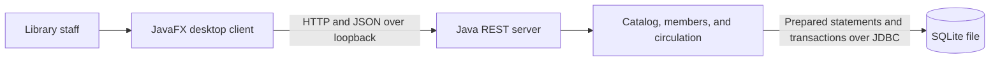

# Library Management System architecture

A single library desk uses a JavaFX desktop client to manage the catalog, register members, and check books out and back in. The project uses Java 21, JavaFX 21, SQLite through JDBC, and a JSON REST API built with the JDK HTTP server. Maven builds the two applications independently in one project.

The client uses Java's HTTP client for API calls off the JavaFX application thread. The server owns validation and the database. It listens on loopback by default at port 8080. The client defaults to `http://127.0.0.1:8080/api`. Set `LIBRARY_PORT`, `LIBRARY_DB`, and `LIBRARY_API_URL` to change the server port, database file, and client API URL respectively.

## Data and circulation rules

- **Book** has an integer ID, unique ISBN, title, author, optional genre, and total copy count. Availability is the total minus the count of open loans.
- **Member** has an integer ID, name, and unique email. A member can have multiple open loans, with at most one for the same book.
- **Loan** has an integer ID, a book and member foreign key, checkout and due dates, and an optional return date. Checkout is due in 14 calendar days. The server calculates dates using its local clock.
- Write transactions serialize competing inventory updates so concurrent checkouts cannot oversubscribe a title. A book's copy count cannot fall below its open loan count. A return closes an open loan and restores availability. Loan history is retained.
- Seed data makes a new database explorable immediately. Startup initializes the schema and seeds a new database once. A single local clerk is the deployment assumption.

## Implementation and verification

1. Define the request and response schemas in [OpenAPI](openapi.json).
2. Implement the JavaFX desk and the Java/JDBC API in parallel against the contract.
3. Build both Maven modules and verify catalog, member, checkout, return, and persistence flows against a temporary database.
4. Launch the server and JavaFX client locally with the persistent database.
